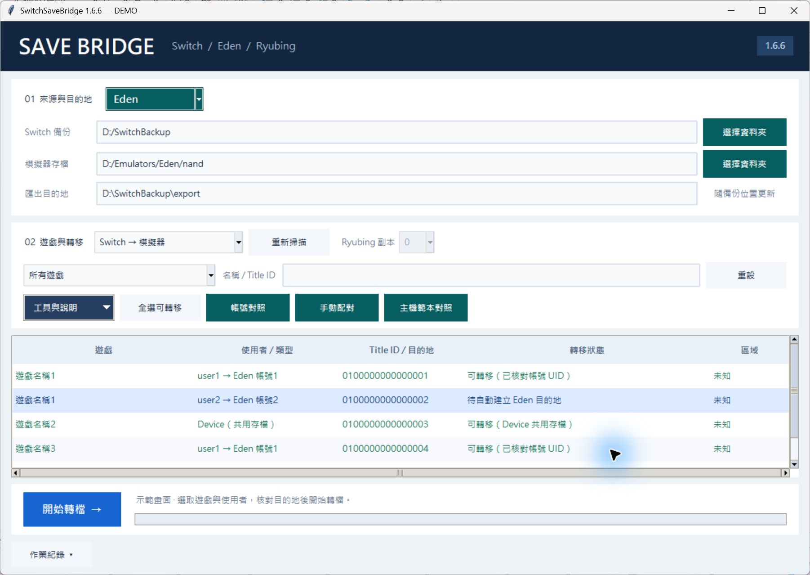

# SwitchSaveBridge

繁體中文 Windows 存檔轉移工具，支援 DBI 解包的 Nintendo Switch 存檔與 Eden、Ryubing／Ryujinx 之間批次匯入／匯出。

## 操作畫面



畫面使用「遊戲名稱1／user1／user2」等示範資料，並非真實存檔。

## 下載

到 [Releases](https://github.com/skypray73/SwitchSaveBridge/releases) 下載 `SwitchSaveBridge-1.6.6-Portable.zip`，解壓縮後執行 EXE，無須安裝 Python。

## 功能

- 預設 Eden，可切換 Ryubing，分別記住路徑與帳號對照。
- 依遊戲名稱或 Title ID 搜尋，支援多選批次轉移。
- 個人帳號與 Device 共用存檔分開處理。
- Eden 可在確認 Title ID 與已登記帳號後，建立缺少的存檔目的地。
- 主機範本對照保留 DBI 的遊戲與使用者資料夾名稱。
- 覆寫前完整備份、SHA-256 複製驗證與目錄替換失敗回復。
- 自動讀寫 config.ini；匯出固定為 Switch 備份根目錄下的 export/批次時間。

## Switch 主機端先備條件

**Switch 主機需先以要使用的帳號執行該遊戲，並至少完成一次手動存檔或自動存檔**，再透過 DBI 讀取及備份。只有安裝遊戲或進入標題畫面，不一定已有可備份的存檔。若有多位使用者，請分別建立各自的存檔；Device 是全機共用資料。

此要求適用於取得主機備份與建立回存範本。模擬器端不同：Eden 可由本工具在確認帳號及 Title ID 後建立目的地；Ryubing／Ryujinx 可右鍵開啟對應的存檔資料夾，不必先實際執行遊戲。

## 快速開始

1. 在 Switch 使用 DBI 的 Run MTP responder，於電腦開啟 7: Saves，複製遊戲存檔至程式旁 atmosphere_save。
2. 目錄應為 `atmosphere_save/遊戲名稱1/user1/存檔內容`；Device 則用 `遊戲名稱1/Device/`。保留 DBI 實際名稱，user1 只是範例。不要多包一層分類資料夾。
3. 選擇模擬器及路徑。Eden 選 `nand`，Ryubing 選 `bis/user/save`。
4. 設定帳號對照，重新掃描，核對 Title ID 後選取並開始轉檔。名稱未識別時使用手動配對。
5. 匯回 Switch 前，先從主機取得該遊戲存檔範本，設定主機範本對照；結果只輸出到電腦，需自行使用主機備份工具還原。

Ryubing 可選對帳號後，在遊戲清單右鍵開啟使用者存檔資料夾以建立目的地；Device 用開啟裝置存檔資料夾。Eden 有效帳號及 Title ID 已確認時，可由本工具建立標準目錄。操作前請完全關閉模擬器。

## 存檔與設定

- Eden：`%APPDATA%/eden/nand/user/save/0000000000000000/帳號UID/TitleID`。全零 UID 為 Device。亦辨識既有新佈局 account/UID/TitleID/0 與 device/TitleID/0。
- Ryubing：`%APPDATA%/Ryujinx/bis/user/save/SaveID`。0／1 是內部副本，不是玩家編號；一般匯出選 0。
- config.ini：路徑及目前模擬器；accounts.json：帳號對照；templates.json：主機範本對照。
- Backups：完整覆寫前備份及每批紀錄。關閉模擬器後，可依備份旁 JSON 的 original 路徑完整還原該目錄，避免合併舊檔。

## 支援範圍

只處理已解包存檔，不包含遊戲、金鑰、韌體、加密 NAND 解密或遊戲版本轉檔。略過 BCAT 與 SD_Cache。區域不能只憑存檔可靠判定，預設未知。自訂 Eden save 根目錄與符號連結／接合點轉移不在本版支援範圍。

測試涵蓋轉移、備份、驗證、回復、帳號與範本對照及 UI 啟動；不同遊戲更新、DLC、地區版本的存檔相容性仍需遊戲內驗證。整批不是單一交易，失敗項目不撤回先前成功項目。

## 從原始碼執行與建置

Python 3.14（含 Tkinter）：

```powershell
python switch_save_bridge.py
python -m pip install pyinstaller==6.22.3
python -m PyInstaller --noconfirm --onefile --windowed --name SwitchSaveBridge --add-data "titles.json;." switch_save_bridge.py
```

建議先在測試副本驗證，再處理重要存檔。執行檔需放在可寫入資料夾。

## 參考

- [DBI 官方說明](https://github.com/rashevskyv/dbi)
- [Eden 原始碼](https://github.com/eden-emulator/mirror)
- [Ryubing 文件](https://github.com/Ryubing/docs)

本專案為獨立工具，與 Nintendo、DBI、Eden 或 Ryubing 團隊無隸屬關係。
